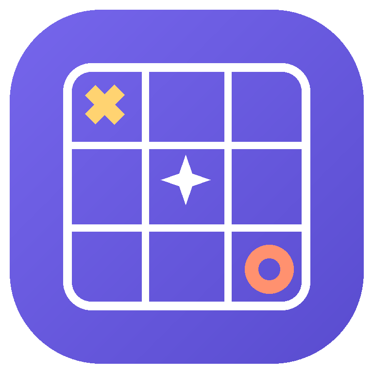
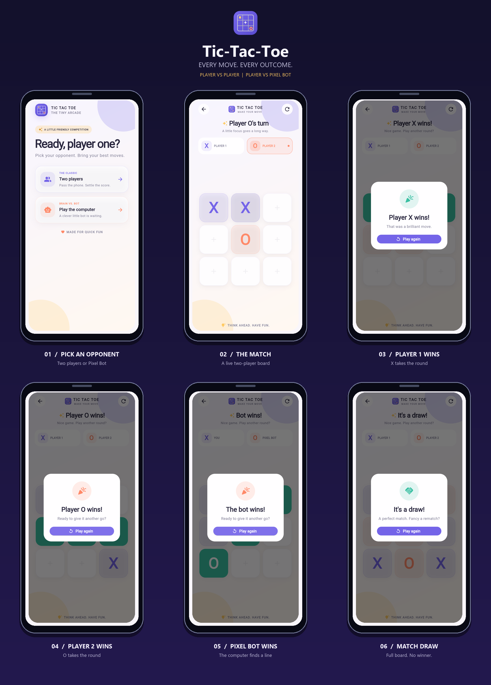

# Tic-Tac-Toe

<p align="center">
  
</p>

A playful Tic-Tac-Toe app and my first mobile project built with Flutter.
Challenge the computer or pass the phone and play with a friend.

## Features

- Play locally with a friend or take on the Minimax-powered Pixel Bot.
- Choose who makes the first move in single-player mode.
- Enjoy a colorful, responsive interface with animated game tiles.
- See winning squares highlighted and get a result for each round.
- Restart a game at any time.

## Game showcase

Each screen highlights a distinct scenario: opponent selection, active play,
victories for both players and the computer, and a draw.



| Scenario | Screenshot |
| --- | --- |
| Setup and opponent selection (two players or Pixel Bot) | [home.png](screenshots/home.png) |
| Active two-player match | [mid-game.png](screenshots/mid-game.png) |
| Player 1 victory | [player-1-victory.png](screenshots/player-1-victory.png) |
| Player 2 victory | [player-2-victory.png](screenshots/player-2-victory.png) |
| Pixel Bot victory | [ai-victory.png](screenshots/ai-victory.png) |
| Match draw / tie | [match-draw.png](screenshots/match-draw.png) |

### Mobile demo

[Watch the mobile gameplay demo](screenshots/mobile-demo.mp4).

## Getting started

### Requirements

- Flutter SDK (Dart 3.7 or later).
- An Android/iOS device or emulator, or another Flutter-supported target.

### Run locally

```sh
flutter pub get
flutter run
```

To check the project with the Dart analyzer:

```sh
flutter analyze
```

## Built with

- [Flutter](https://flutter.dev/)
- [Dart](https://dart.dev/)
- Minimax algorithm for the computer opponent

## License

This project is licensed under the GNU General Public License v3.0. See
[LICENSE](LICENSE) for the full license text.
