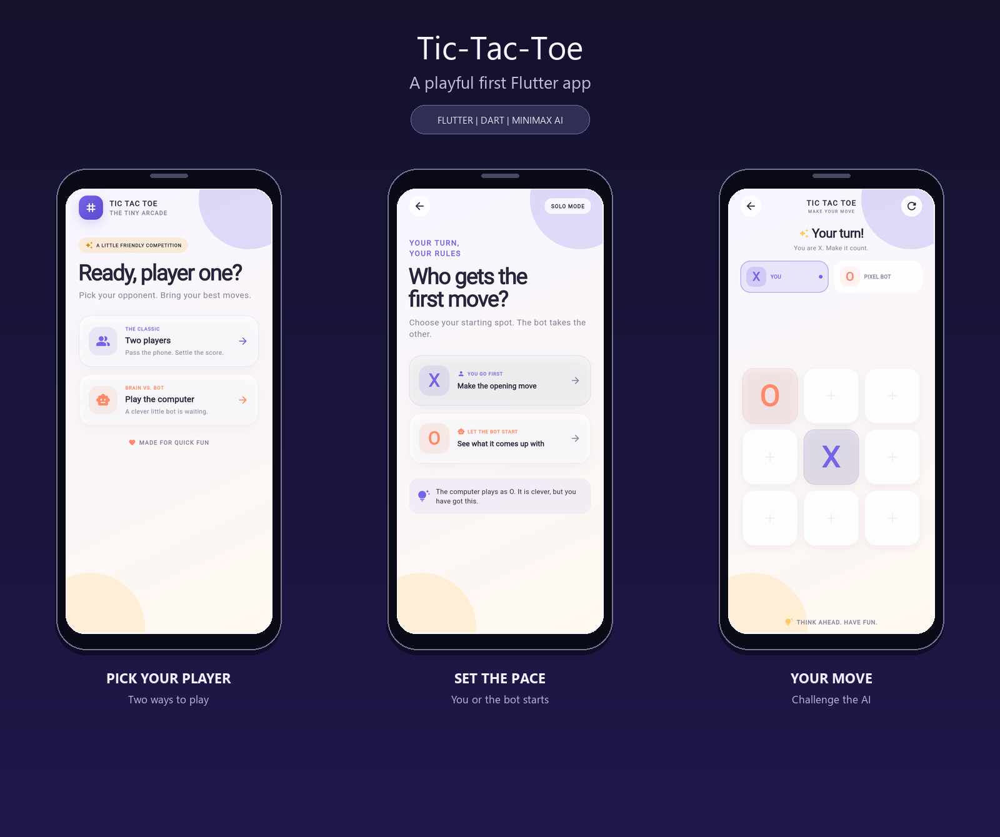

# Tic-Tac-Toe

A playful Tic-Tac-Toe app and my first mobile project built with Flutter.
Challenge the computer or pass the phone and play with a friend.

## Features

- Play locally with a friend or take on the Minimax-powered Pixel Bot.
- Choose who makes the first move in single-player mode.
- Enjoy a colorful, responsive interface with animated game tiles.
- See winning squares highlighted and get a result for each round.
- Restart a game at any time.

## Preview



### Mobile demo

[Watch the mobile gameplay demo](screenshots/mobile-demo.mp4).

### Screenshots

- [Choose a game mode](screenshots/home.png)
- [Choose who starts](screenshots/choose-starting-player.png)
- [Single-player board](screenshots/single-player-game.png)
- [Playing against Pixel Bot](screenshots/single-player-move.png)
- [Two-player board](screenshots/two-player-board.png)
- [Winning a round](screenshots/game-result.png)

## Getting started

### Requirements

- Flutter SDK (Dart 3.7 or later).
- An Android/iOS device or emulator, or another Flutter-supported target.

### Run locally

```sh
flutter pub get
flutter run
```

To check the project with the Dart analyzer:

```sh
flutter analyze
```

## Built with

- [Flutter](https://flutter.dev/)
- [Dart](https://dart.dev/)
- Minimax algorithm for the computer opponent

## License

This project is licensed under the GNU General Public License v3.0. See
[LICENSE](LICENSE) for the full license text.
